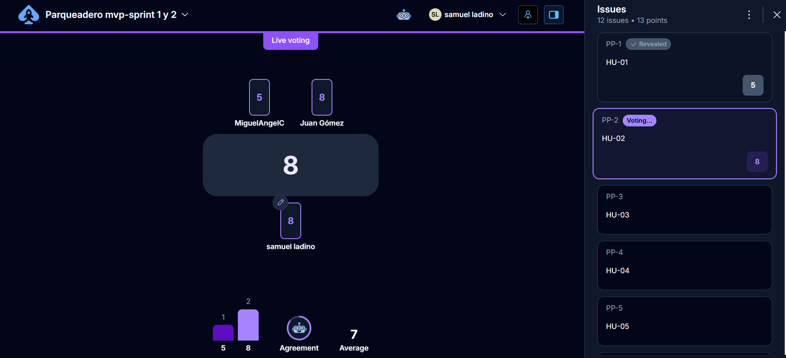
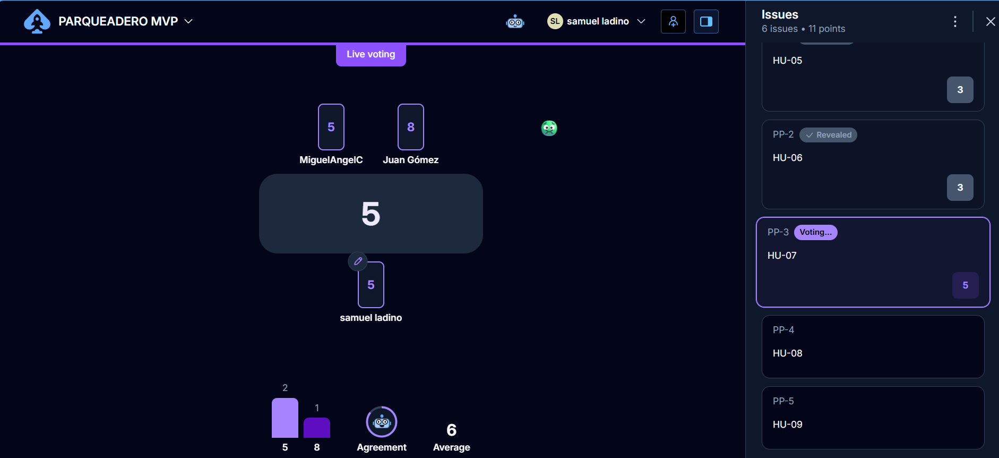
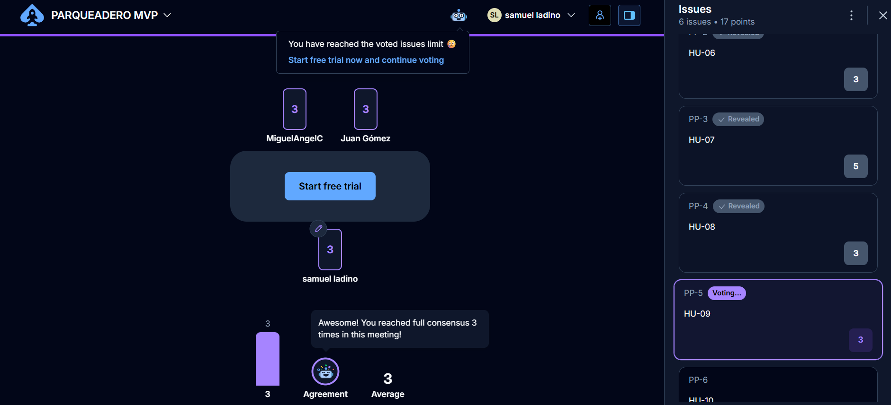

# Sprint 0 – Configuración

**Fechas:** 23 al 25 de noviembre de 2026
**Scrum Master:** Juan Gómez · **Product Owner:** Samuel Ladino · **Desarrollo:** Miguel Castrillón (los tres desarrollan)

## Objetivo del sprint

Dejar listos el repositorio con GitFlow, el tablero Scrum, el backlog estimado y el entorno de desarrollo, para empezar a construir funcionalidades en el Sprint 1.

## Sprint backlog y resultado

| Ítem | Responsable | Evidencia | Estado |
|---|---|---|---|
| Repositorio, ramas `main`/`develop` y reglas de protección | Samuel | Ruleset "Doble revisión obligatoria" | ✅ Hecho |
| Tablero en GitHub Projects con sprints y campos | Samuel | Proyecto "Parqueadero MVP - Scrum" | ✅ Hecho |
| Backlog HU-01 a HU-10 con criterios de aceptación | Samuel (PO) | Issues #3 a #12 | ✅ Hecho |
| HU-00 Esqueleto del backend (Spring Boot 4.2, Java 21) | Samuel | PR #2, aprobado por Miguel | ✅ Hecho |
| CI, plantilla de PR, definición de terminado y roles | Juan | PR #13, aprobado por Samuel | ✅ Hecho |
| Docker Compose, `.env.example` y migración V1 | Miguel | PR #15, aprobado por Samuel | ✅ Hecho |
| Planning Poker del backlog | Equipo (modera Juan) | Tabla y capturas de esta sección | ✅ Hecho |

## Planning Poker

- **Herramienta:** planningpokeronline.com, escala Fibonacci.
- **Dinámica:** el PO lee la historia y sus criterios de aceptación, se resuelven dudas, los tres votan a la vez y se revelan las cartas. Si hay diferencia, se discute y se acuerda el valor final.
- **Observación:** el plan gratuito de la herramienta limita el número de historias por sala, por eso la estimación se hizo en dos salas. HU-10 no alcanzó a votarse y conserva por ahora la estimación inicial del PO.

| HU | Historia | Miguel | Juan | Samuel | Final | Sprint |
|---|---|---|---|---|---|---|
| HU-01 | Ingreso por placa (F-01) | – | – | – | 5 | 1 |
| HU-02 | Clasificación moto/carro (F-02) | 5 | 8 | 8 | 8 | 1 |
| HU-03 | Lectura manual por baja confianza (F-06) | – | – | – | 3 | 1 |
| HU-04 | Control de cupos (F-07) | 5 | 5 | 5 | 5 | 1 |
| HU-05 | Administración de tarifas (F-08) | – | – | – | 3 | 1 |
| HU-06 | Acceso por roles (F-10) | – | – | – | 3 | 1 |
| HU-07 | Generación del cobro (F-03) | 5 | 8 | 5 | 5 | 2 |
| HU-08 | Registro de pago en efectivo (F-04) | 3 | 5 | 3 | 3 | 2 |
| HU-09 | Salida con barrera (F-05) | 3 | 3 | 3 | 3 | 2 |
| HU-10 | Consulta de eventos y cobros (F-09) | – | – | – | 3 * | 2 |

"–": en las capturas solo quedó registrado el valor final, no el voto individual.
\* Estimación inicial del PO, pendiente de votar.

**Totales:** Sprint 1 = 27 puntos · Sprint 2 = 14 puntos.

### Evidencias

**HU-02: hubo diferencia (5 / 8 / 8) y se acordó 8.**

**HU-07: hubo diferencia (5 / 8 / 5) y se acordó 5.**

**HU-09: consenso total (3 / 3 / 3).**

## Sprint review

- **Terminado:** todo el sprint backlog. El esqueleto del backend, el CI, la DoD, el entorno con Docker y la migración V1 están integrados en `develop` mediante pull requests revisados por otro integrante.
- **Revisión de código:** en el PR #15 se pidieron correcciones y se aplicaron antes del merge: estados `VENCIDO` y `ANULADO` en el cobro, valores de ejemplo en `.env.example` y el tipo de evento `INGRESO` en lugar de `ENTRADA`.
- **No terminado a tiempo:** el sprint estaba planeado para el 23 de noviembre y se extendió hasta el 25.

## Retrospectiva

- 👍 **Qué salió bien:** el flujo de GitFlow con PR y revisión obligatoria funcionó desde el primer día, y la revisión del PR #15 detectó problemas en el esquema antes de que llegaran a `develop`.
- 👎 **Qué mejorar:** los aportes se subieron tarde y eso extendió el sprint dos días. Además, HU-02 quedó estimada por encima de HU-07, aunque HU-07 depende de ella.
- 🎯 **Acciones para el Sprint 1:**
  1. Subir avances a la rama y abrir el PR como borrador desde el primer día, sin esperar a terminar.
  2. Revisar la estimación de HU-02 frente a HU-07 al iniciar el Sprint 1 y votar HU-10.

## Planeación del Sprint 1

- **Objetivo:** "Un vehículo entra". Inicio de sesión con roles, ingreso por placa con clasificación, lectura manual, control de cupos y administración de tarifas.
- **Sprint backlog:** HU-01 a HU-06 (27 puntos).
- **Riesgo:** el Sprint 1 tiene casi el doble de puntos que el Sprint 2. HU-06 se considera prioritaria porque permite habilitar el acceso a los endpoints según los roles. Si falta tiempo, el PO revisará el alcance de las demás historias del sprint.
