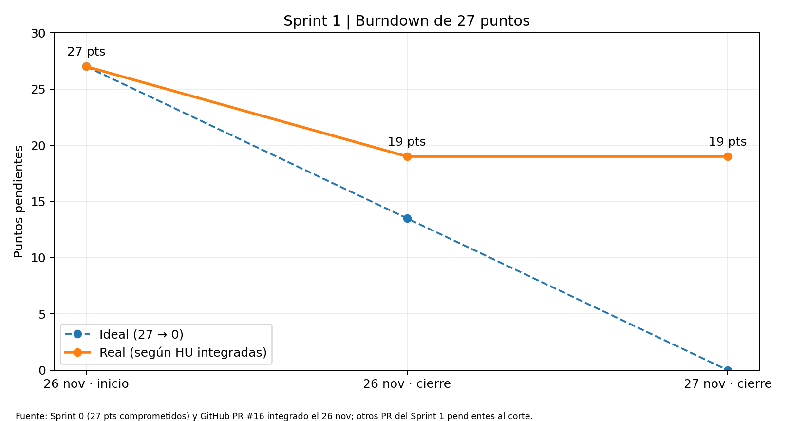

# Sprint 1 – Un vehículo entra

**Periodo de referencia:** 26 y 27 de noviembre de 2026.  
**Scrum Master:** Juan Gómez · **Product Owner:** Samuel Ladino · **Desarrollo:** Miguel Castrillón. Los tres participan en el desarrollo.  
**Backlog comprometido:** HU-01 a HU-06, 27 puntos.  
**Corte del informe:** noche del 27 de noviembre, según el estado verificable de GitHub.  
**Nota:** Samuel indicó que el Sprint 1 está cerrado. Los acuerdos de la reunión de review y retrospectiva aún deben ser confirmados por el equipo; no se presentan como reuniones realizadas.

## Objetivo del sprint

Conseguir el flujo de ingreso de un vehículo: identificar y clasificar su placa, resolver lecturas dudosas, consultar cupos y contar con tarifas configurables, restringiendo las operaciones según los roles ADMIN y OPERADOR.

## Backlog y resultado del sprint

| Historia | Responsable | Puntos | Evidencia | Estado al cierre consultado |
|---|---|---:|---|---|
| HU-01 – Registro de ingreso por placa | Samuel | 5 | PR #17 | PR abierto; no integrado |
| HU-02 – Clasificación carro/moto | Samuel | 8 | PR #16 | **Integrado a `develop`** el 26/11 |
| HU-03 – Lectura manual por baja confianza | Samuel | 3 | PR #19 | PR en borrador; no integrado |
| HU-04 – Control de cupos | Miguel | 5 | PR #20 | PR en borrador; no integrado |
| HU-05 – Administración de tarifas | Juan | 3 | PR #22 | PR en borrador; 32 pruebas locales y CI correctos; no integrado |
| HU-06 – Acceso por roles | Juan | 3 | PR #21 | PR en borrador; 37 pruebas locales y CI correctos; ajustes de revisión subidos; no integrado |
| **Total** | | **27** | | **8 puntos integrados; 19 pendientes** |

El criterio para contar puntos terminados en este informe es **historia integrada en `develop`**, no simplemente un PR abierto ni un CI correcto. Esta distinción permite que el burndown refleje trabajo entregado y no solo código desarrollado.

## Evidencias del avance

- **HU-02:** se integraron `Placa`, `TipoVehiculo` y las reglas de clasificación; el PR #16 tiene pruebas automatizadas.
- **HU-01:** el PR #17 propone los endpoints de ingreso y su persistencia, pero sigue pendiente de aprobación e integración.
- **HU-03:** el PR #19 propone la validación de lecturas dudosas y depende de HU-01.
- **HU-04:** el PR #20 propone el control de cupos; Miguel debe terminar de verificar su integración.
- **HU-05:** el PR #22 incluye el modelo de tarifas, API REST, persistencia JPA y validaciones (RN-01 y RN-02). Tiene 32 pruebas locales aprobadas y GitHub Actions en verde. Falta revisar la integración con PostgreSQL, HU-04, HU-06 y la generación del cobro.
- **HU-06:** el PR #21 incluye HTTP Basic sin sesión, BCrypt, permisos ADMIN/OPERADOR y `GET /api/auth/yo`. Los errores 401/403 se unificaron con `ProblemDetail` y se renombró `AutenticacionControlador`, según la revisión de Samuel. Tiene 37 pruebas locales aprobadas y CI en verde. Falta probar usuarios reales con V2.
- **Datos iniciales V2:** Samuel se encargará de la migración con sede, usuarios, tarifas y cupos cuando se integren HU-01 y HU-06. No se creará una V2 paralela.

## Burndown (puntos pendientes)

| Corte | Puntos al inicio | Puntos terminados acumulados | Puntos pendientes |
|---|---:|---:|---:|
| 26/11, inicio | 27 | 0 | 27 |
| 26/11, cierre | 27 | 8 (HU-02) | 19 |
| 27/11, cierre | 27 | 8 | 19 |

**Método:** se restan del total comprometido los puntos de historias integradas al final de cada fecha. La línea ideal es una referencia visual; la línea real se obtuvo de los PR y su estado de merge. El gráfico no demuestra que se hayan realizado las ceremonias Scrum.

**Evidencia adicional pendiente:** captura del tablero en GitHub Projects → Insights, filtrado por las historias del Sprint 1. GitHub dispone de un gráfico histórico *Burn up*; la imagen anterior representa el *Burndown* calculado con puntos pendientes y no se debe confundir con el gráfico nativo.

## Sprint review – balance del cierre

**Resultado verificable:** HU-02 quedó integrada y las demás HU se encontraban en revisión. El objetivo completo del ingreso no se puede considerar demostrado de punta a punta sobre `develop` mientras HU-01, HU-03, HU-04, HU-05 y HU-06 sigan abiertas.

**Dependencias principales:** aprobación e integración de HU-01 y HU-06 para habilitar la operación y la V2; integración de cupos y tarifas para que Miguel pueda enlazar HU-07 (generación del cobro).

**Pendiente de completar tras la reunión real:** fecha, asistentes, funciones demostradas, retroalimentación de Samuel como Product Owner y decisión de aceptación o arrastre de cada historia.

## Retrospectiva – insumos propuestos para validar con el equipo

### Qué salió bien

- GitFlow y las revisiones por Pull Request ayudaron a mantener aislados los cambios de cada integrante.
- GitHub Actions permitió detectar fallos antes de solicitar la integración.
- La revisión de HU-06 permitió unificar el nombre del controlador y el formato `ProblemDetail` para el frontend.

### Qué debemos mejorar

- El alcance de 27 puntos resultó difícil de integrar en un sprint de dos días.
- Varias historias dependen de otras y abrieron PR sin poder demostrar todavía el flujo completo.
- Debemos coordinar antes los contratos entre ingreso, roles, cupos, tarifas y cobros.

### Acciones propuestas para el Sprint 2

1. Priorizar las revisiones de HU-01 y HU-06 y luego confirmar la migración V2 con Samuel.
2. Integrar HU-05 con los cupos de HU-04 sin duplicar lógica y compartir su contrato con Miguel.
3. Planear en orden los casos de uso de generación de cobro (HU-07), pago (HU-08) y salida (HU-09).
4. Ejecutar pruebas conjuntas sobre PostgreSQL y guardar capturas reales para la demostración.
5. Actualizar los estados del tablero y el burndown después de cada integración.

**Aclaración:** estos son hallazgos derivados del trabajo y propuestas para la conversación del equipo. Se deben ajustar con lo que Samuel y Miguel efectivamente acuerden en la review y retrospectiva.

## Transición al Sprint 2

El backlog inicial del Sprint 2 reúne HU-07 (5 puntos), HU-08 (3), HU-09 (3) y HU-10 (3): **14 puntos**. Hay además **19 puntos del Sprint 1 todavía no integrados** a este corte. Samuel, como Product Owner, debe decidir qué trabajo pendiente se arrastra y con qué prioridad, sin marcarlo retrospectivamente como terminado.

**Pendientes de documentación Scrum:** registrar asistentes y acuerdos reales de la review/retro; anexar captura de Insights de GitHub Projects; actualizar la tabla de iteraciones una vez se acuerde el alcance del Sprint 2.
